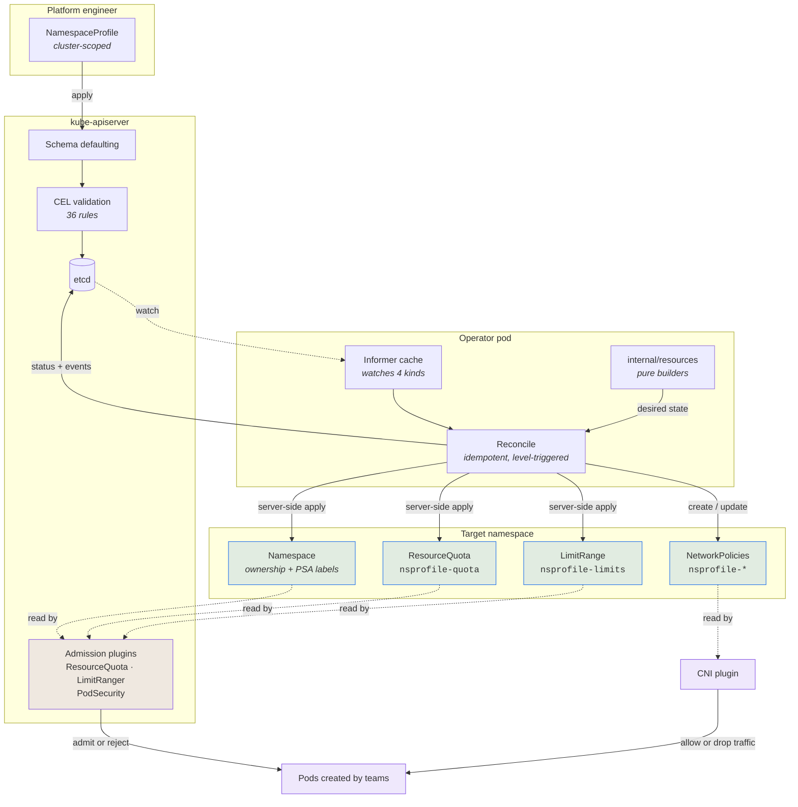
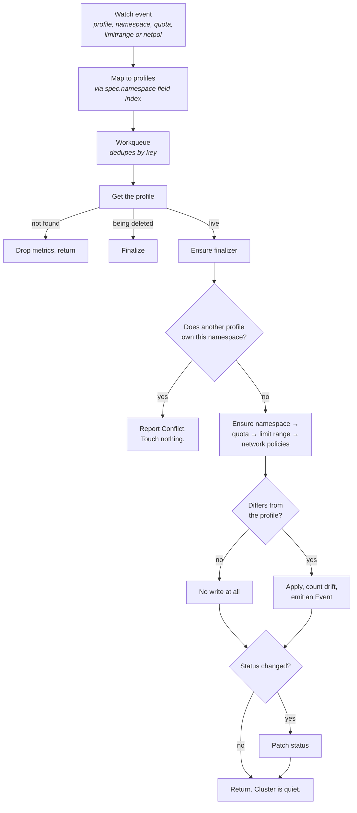

# namespace-bootstrap-operator

<!-- The Release badge stays grey until the workflow has run on the default branch.
     Go Report Card is deliberately absent: the service is retired and now returns a
     "retired" badge for every repository. -->
[](https://github.com/Beem0807/namespace-bootstrap-operator/actions/workflows/release.yml)
[](#required-tooling)
[](go.mod)
[](LICENSE)

A Kubernetes operator that turns a declarative `NamespaceProfile` into a fully
governed namespace: resource quota, container limits, a network fence, and a Pod
Security Admission level — then keeps them that way.

```yaml
apiVersion: platform.nabeem.com/v1alpha1
kind: NamespaceProfile
metadata:
  name: payments-profile
spec:
  namespace: payments
  quota:
    requests: {cpu: "8", memory: 16Gi, ephemeralStorage: 20Gi}
    limits:   {cpu: "16", memory: 32Gi}
    pods: 50
  limitRange:
    defaultRequest: {cpu: 100m, memory: 128Mi}
    max:            {cpu: "4", memory: 8Gi}
  network:
    defaultDenyIngress: true
    allowDNS: true
    allowSameNamespace: true
  security:
    podSecurityStandard: restricted
```

---

## The problem

Onboarding a tenant namespace is a checklist nobody remembers in full: create the
namespace, cap its share of the cluster, give containers sane defaults so the cap
doesn't reject every pod, fence the network, set a Pod Security level. Miss one and
the namespace is either unusable or unbounded.

Worse, the checklist doesn't stay done. Someone raises a quota "just for today",
strips a Pod Security label to debug a deployment, or deletes a NetworkPolicy that
was blocking a test. Nothing alerts, because nothing is watching.

This operator makes the checklist a declaration and the declaration continuously
true. It does **not** manage workloads — enforcement is left entirely to the
Kubernetes mechanisms a profile configures.

## Architecture



The operator writes four kinds of object and then gets out of the way. It never
sees a Pod. The API server's admission plugins and the cluster's CNI do all the
enforcing, reading the objects the operator maintains.

### Reconciliation flow



Two properties this diagram is drawn to make obvious:

- **Nothing is written when nothing differs.** A settled cluster produces zero
  writes, which is what stops the status write → watch event → reconcile → status
  write loop.
- **A profile that doesn't own the namespace does nothing at all** — it does not
  retry, because a conflict is resolved by a person.

---

## Why not just a Helm chart and ArgoCD?

A fair question, and for many teams the honest answer is **use the chart**. A chart
templating `Namespace`, `ResourceQuota`, `LimitRange` and `NetworkPolicy`, synced by
ArgoCD with:

```yaml
syncPolicy:
  automated: { selfHeal: true, prune: true }
```

gives you drift correction, pruning, Git as the source of truth, review, audit and
rollback — with no controller to operate. If you own the namespaces, are comfortable in
YAML, and have a handful of them, that is the right tool and this operator is overkill.

### Where templating stops being enough

**A chart can render invalid policy. A CRD can refuse it.**

```yaml
limitRange:
  min: {cpu: "2"}
  max: {cpu: "1"}        # no pod can ever be admitted here
```

Helm renders that, ArgoCD applies it, and you discover it when every Deployment in the
namespace starts failing admission. The same values submitted as a NamespaceProfile are
rejected on write:

```console
$ kubectl apply -f bad-profile.yaml
Error: limitRange.min must not exceed limitRange.max
```

A values file has no admission step. The 36 CEL rules on this CRD have no chart
equivalent — reserved namespaces, contradictory lifecycle settings, a default-deny
egress that would take DNS down with it, re-pointing a live profile at another
namespace.

**Some correctness is conditional logic, not substitution.** A NetworkPolicy restricts
a direction the moment it names that direction in `policyTypes` — so an *allow*
same-namespace policy that lists `Egress` while you have not asked to deny egress
silently cuts the namespace off from DNS, the API server and the internet. That is
expressible in Go templating, as nested conditionals nobody reviews correctly. Here it
is a function with a test per combination.

**A chart hits a drift problem this operator had to solve.** The API server *mutates*
Container-scoped LimitRange items on write: an unset `default` takes `max`'s value, then
`defaultRequest` takes `default`'s. So the stored object never equals what you
committed, and ArgoCD reports `OutOfSync` forever until somebody discovers it and adds
`ignoreDifferences`. The operator replicates that defaulting so desired state equals
stored state.

**Behaviours are not manifests.** These are decisions made against live cluster state,
and no template expresses them:

| Situation | Chart + ArgoCD | This operator |
| --- | --- | --- |
| Two teams target one namespace | last sync wins, silently | arbitrated deterministically; the loser reports a conflict and touches nothing |
| The namespace already exists, owned by somebody else | applied over | refused unless `adoptExisting` is set |
| The Application is deleted with `prune: true` | **deletes the namespace and every workload in it** | namespace retained unless four independent checks pass |
| Someone adds a quota key by hand | pruned, or fought, depending on config | left alone — it is not a key the operator recorded |

**The interface is a guardrail, not a template.** With a chart the tenant-facing
contract is a values file plus, in practice, access to raw YAML. With the CRD a team
gets a validated, documented API and *cannot express an invalid namespace* — while
write access to a NamespaceProfile stays cluster-admin-adjacent for the reasons in
[Who may create or update a NamespaceProfile](#who-may-create-or-update-a-namespaceprofile).

### Using it with ArgoCD

These compose, and the combination is better than either alone. Let ArgoCD own the
*declarations* and the operator own the *enforcement*:

```yaml
apiVersion: argoproj.io/v1alpha1
kind: Application
metadata:
  name: namespace-profiles
  namespace: argocd
spec:
  project: platform
  source:
    repoURL: https://github.com/your-org/platform-config
    path: namespace-profiles        # a directory of NamespaceProfile YAMLs
    targetRevision: main
  destination:
    server: https://kubernetes.default.svc
  syncPolicy:
    automated:
      selfHeal: true
      prune: true                   # safe here - see below
```

You get Git review and history on the declaration, CEL validation at admission, and a
controller that owns the messy parts.

What makes this clean is that **ArgoCD never sees the generated objects.** Only the
profiles are in Git; the quota, limit range and network policies are created by the
operator and carry no ArgoCD tracking label. So:

- `prune: true` is safe. Deleting a profile from Git deletes the profile, and the
  operator's finalizer then removes what it generated — it does not delete the
  namespace. The dangerous pruning case simply does not arise.
- There is nothing to `ignoreDifferences` for. ArgoCD diffs profiles, which the
  operator never writes to except in `status` — and status is excluded from diffing by
  default.
- An out-of-band edit to a generated resource is the operator's problem, not ArgoCD's,
  so the two never fight over the same field.

Teach ArgoCD what a healthy profile looks like, and an Application goes green only once
the namespaces are actually governed:

```yaml
# argocd-cm ConfigMap
resource.customizations.health.platform.nabeem.com_NamespaceProfile: |
  -- Collect first, decide after: conditions are an unordered list, so deciding
  -- inside the loop would let whichever happens to come first win.
  hs = {}
  local ready, degraded
  if obj.status ~= nil and obj.status.conditions ~= nil then
    for _, c in ipairs(obj.status.conditions) do
      if c.type == "Ready"    then ready = c    end
      if c.type == "Degraded" then degraded = c end
    end
  end
  if degraded ~= nil and degraded.status == "True" then
    hs.status = "Degraded"; hs.message = degraded.message; return hs
  end
  if ready ~= nil and ready.status == "True" then
    hs.status = "Healthy"; hs.message = ready.message; return hs
  end
  if ready ~= nil then
    -- Not Ready but not Degraded: a namespace conflict or a refused adoption.
    -- Surfaces the operator's own message in the ArgoCD UI.
    hs.status = "Progressing"; hs.message = ready.message; return hs
  end
  hs.status = "Progressing"
  hs.message = "Waiting for the profile to be provisioned"
  return hs
```

A namespace conflict or a refused adoption then surfaces in the ArgoCD UI with the
operator's own message, rather than as a green tick over a profile doing nothing.

### When not to use this

- You manage a few namespaces you control yourself — a chart is less machinery.
- You need policy this API does not express, and would end up with raw manifests
  alongside it anyway. Two sources of truth is worse than one.
- Your cluster is below Kubernetes 1.30, where the CRD's `isCIDR()` rule will not
  compile.
- Nobody is going to operate the controller. An unmaintained operator is worse than a
  chart.

---

## Install

### With Helm (recommended)

```bash
helm repo add namespace-bootstrap-operator https://release.nabeem.com/charts/namespace-bootstrap-operator
helm repo update
helm install nbo namespace-bootstrap-operator/namespace-bootstrap-operator \
  --namespace nbo-system --create-namespace
```

### Locally against Kind

```bash
make kind-deploy          # creates the cluster, builds, loads, helm-installs
kubectl apply -f config/samples/platform_v1alpha1_namespaceprofile.yaml
kubectl get nsp
```

```
NAME               NAMESPACE   PHASE   READY   COMPLIANT   AGE
payments-profile   payments    Ready   True    True        12s
```

### Without Helm

```bash
make install    # CRDs only
make deploy IMG=docker.io/nabeemdev/namespace-bootstrap-operator:latest
```

### Required tooling

**Kubernetes 1.30 or later.** Two independent things set that floor: the CRD's
`isCIDR()` validation rule needs the CEL IP/CIDR library, gated at 1.30 in the API
server (`k8s.io/apiserver/pkg/cel/environment/base.go`), and the optional admission
policy needs `ValidatingAdmissionPolicy`, which went GA in the same release.

| Tool | Version | Notes |
|---|---|---|
| Go | 1.26.3 | controller-runtime v0.25 requires ≥ 1.26.0 |
| Kubebuilder | v4.16.0 | only for `make helm-regenerate` |
| controller-runtime | v0.25.2 | pins `k8s.io/*` at v0.37.0 |
| envtest assets | 1.37.0 | `make setup-envtest` |
| Kind | v0.33.0 | node image pinned to `v1.37.0` |
| Helm | v3 or v4 | `make install-helm` fetches one |

Everything else (`controller-gen`, `kustomize`, `setup-envtest`, `golangci-lint`)
is downloaded into `bin/` at pinned versions by the Makefile. Nothing needs to be
installed globally.

---

### Seeing it work

Every transcript below is captured from a real Kind cluster running the chart with the
image pulled from Docker Hub — not illustrative output.

```console
$ kubectl apply -f config/samples/platform_v1alpha1_namespaceprofile.yaml
namespaceprofile.platform.nabeem.com/payments-profile created

$ kubectl get nsp
NAME               NAMESPACE   PHASE   READY   COMPLIANT   AGE
payments-profile   payments    Ready   True    True        1s
```

Ready in about a second. The status says what it did and how it assesses each resource:

```console
$ kubectl get nsp payments-profile -o jsonpath='{range .status.conditions[*]}{.type}{"\t"}{.status}{"\t"}{.reason}{"\n"}{end}'
Ready            True     Provisioned
Progressing      False    Provisioned
Degraded         False    Provisioned
PolicyCompliant  True     Provisioned

$ kubectl get nsp payments-profile -o jsonpath='{range .status.managedResources[*]}{.kind}/{.name}{"\t"}{.state}{"\n"}{end}'
Namespace/payments                             InSync
ResourceQuota/nsprofile-quota                  InSync
LimitRange/nsprofile-limits                    InSync
NetworkPolicy/nsprofile-default-deny-ingress   InSync
NetworkPolicy/nsprofile-allow-same-namespace   InSync
```

The labels it owns on the namespace — and nothing else, so anything else already there
survives:

```console
$ kubectl get ns payments -o jsonpath='{.metadata.labels}' | jq
app.kubernetes.io/managed-by=namespace-bootstrap-operator
platform.nabeem.com/profile=payments-profile
pod-security.kubernetes.io/enforce=restricted
pod-security.kubernetes.io/enforce-version=latest
pod-security.kubernetes.io/audit=restricted
pod-security.kubernetes.io/audit-version=latest
pod-security.kubernetes.io/warn=restricted
pod-security.kubernetes.io/warn-version=latest
```

The whole quota the sample declares, in one object:

```console
$ kubectl get resourcequota nsprofile-quota -n payments -o jsonpath='{.spec.hard}' | jq
  requests.cpu:                                                8
  requests.memory:                                             16Gi
  requests.ephemeral-storage:                                  20Gi
  limits.cpu:                                                  16
  limits.memory:                                               32Gi
  limits.ephemeral-storage:                                    40Gi
  pods:                                                        50
  requests.storage:                                            500Gi
  persistentvolumeclaims:                                      20
  fast-ssd.storageclass.storage.k8s.io/requests.storage:       200Gi
  fast-ssd.storageclass.storage.k8s.io/persistentvolumeclaims: 10
  services:                                                    10
  services.loadbalancers:                                      0
  secrets:                                                     50
  configmaps:                                                  50
  count/deployments.apps:                                      20
  count/cronjobs.batch:                                        5
  count/serviceaccounts:                                       10
```

Only the policies the profile actually asks for. The sample denies ingress but not
egress, so there is no egress-deny and no DNS allowance — and the same-namespace
allowance names `Ingress` only, because naming a direction is what restricts it:

```console
$ kubectl get netpol -n payments -o custom-columns=NAME:.metadata.name,TYPES:.spec.policyTypes
NAME                             TYPES
nsprofile-default-deny-ingress   [Ingress]
nsprofile-allow-same-namespace   [Ingress]
```

With `admissionPolicy.enabled=true`, editing a managed resource is refused rather than
silently reverted:

```console
$ kubectl patch resourcequota nsprofile-quota -n payments \
    --type=merge -p '{"spec":{"hard":{"requests.cpu":"64"}}}'
Error from server (Forbidden): resourcequotas "nsprofile-quota" is forbidden:
ValidatingAdmissionPolicy '...-managed-resources-protected' denied request: this
resource is managed by the Namespace Bootstrap Operator; change the NamespaceProfile
that declares it (platform.nabeem.com/profile=payments-profile) instead of editing
this object directly

$ kubectl label ns payments pod-security.kubernetes.io/enforce-
Error from server (Forbidden): namespaces "payments" is forbidden:
ValidatingAdmissionPolicy '...-namespace-labels-protected' denied request: the
ownership and Pod Security labels on this namespace are managed by the Namespace
Bootstrap Operator ... Every other label on this namespace remains editable.

$ kubectl label ns payments cost-center=platform-eng
namespace/payments labeled
```

That last one is the point of a label-scoped policy rather than a blanket one: the
namespace stays editable, and only the keys the operator owns are frozen.

### Chart configuration

Full defaults are in [`dist/chart/values.yaml`](dist/chart/values.yaml). The values
worth knowing about:

| Value | Default | Effect |
| --- | --- | --- |
| `manager.image.repository` | `docker.io/nabeemdev/namespace-bootstrap-operator` | where to pull from |
| `manager.image.tag` | *(unset)* | **falls back to `Chart.appVersion`**, so the chart and image versions cannot silently diverge |
| `manager.image.pullPolicy` | `IfNotPresent` | set `Never` for a locally side-loaded image |
| `manager.replicas` | `1` | safe to raise: leader election means only one replica reconciles |
| `manager.resources` | `500m`/`128Mi` limits, `10m`/`64Mi` requests | the operator is cheap; it watches four low-cardinality kinds and no pods |
| `manager.args` | `[--leader-elect]` | manager flags |
| `manager.healthProbe.port` | `8081` | `/healthz` and `/readyz` |
| `manager.affinity`, `nodeSelector`, `tolerations` | empty | standard scheduling controls |
| `admissionPolicy.enabled` | `false` | opt in to **preventing** edits rather than correcting them — see [Two modes](#two-modes-correct-after-or-prevent-before) |
| `admissionPolicy.namespaceSelector` | `{}` | pilot prevention on selected namespaces before enabling it everywhere |
| `rbac.helpers.enabled` | `false` | install the `namespaceprofile-{admin,editor,viewer}` ClusterRoles — see [Who may create or update a NamespaceProfile](#who-may-create-or-update-a-namespaceprofile) |
| `serviceAccount.enabled` | `true` | set `false` plus `serviceAccount.name` to use an existing one |
| `crd.enabled` | `true` | set `false` if you manage the CRD separately, e.g. by GitOps |
| `crd.keep` | `true` | see the warning below |
| `metrics.enabled` | `true` | serve the metrics endpoint |
| `metrics.port` | `8443` | |
| `metrics.secure` | `true` | require authentication and authorization to scrape |
| `prometheus.enabled` | `false` | install a `ServiceMonitor` (needs the Prometheus Operator) |
| `networkPolicy.enabled` | `false` | see the warning below |

```bash
helm install nbo namespace-bootstrap-operator/namespace-bootstrap-operator \
  --namespace nbo-system --create-namespace \
  --set admissionPolicy.enabled=true \
  --set rbac.helpers.enabled=true \
  --set manager.replicas=2
```

Preview any change before applying it:

```bash
helm diff upgrade nbo namespace-bootstrap-operator/namespace-bootstrap-operator \
  --set admissionPolicy.enabled=true        # needs the helm-diff plugin
helm template nbo dist/chart --set admissionPolicy.enabled=true   # or just render it
```

#### Four values that do not mean what their names suggest

> **`rbac.namespaced: true` breaks the operator.** It converts the manager's
> `ClusterRole` into a namespaced `Role`, and a `Role` cannot grant access to
> cluster-scoped resources — which `NamespaceProfile` and `Namespace` both are. The
> operator would start and then fail every reconciliation with `Forbidden`. The value
> exists because the chart is generated from a kubebuilder scaffold that supports
> namespace-scoped operators; this one is not. Leave it `false`.

> **`crd.keep: true` means `helm uninstall` leaves the CRD behind.** It stamps
> `helm.sh/resource-policy: keep` on the CRD, so uninstalling the chart does not delete
> your `NamespaceProfile` objects — which is almost always what you want, since deleting
> the CRD would delete every profile, and each profile's finalizer would then run
> cleanup across every governed namespace. Set it `false` only if you genuinely intend
> an uninstall to tear all of that down.

> **`networkPolicy.enabled` has nothing to do with the policies the operator
> generates.** It installs a single NetworkPolicy protecting the *operator's own*
> metrics port. Tenant network policies come from `spec.network` on a profile and are
> unaffected by this value.

> **`certManager.enabled` and `webhook.*` do nothing.** This operator serves no
> webhooks, so there is no certificate to manage. The values are scaffold residue; the
> webhook flags have been removed from the manager binary.

## The custom resource

`NamespaceProfile` is **cluster-scoped**. Creating a namespace and choosing its Pod
Security level are cluster-level powers, so the resource conferring them should not
be grantable inside a single namespace. It also makes `metadata.name` unique, which
is what lets namespace ownership be recorded in one label.

### `spec`

| Field | Type | Meaning |
|---|---|---|
| `namespace` | string, **required**, immutable | the namespace this profile governs. `kube-*` and `default` are rejected |
| `adoptExisting` | bool, default `false` | may the operator take over a namespace or object it did not create? |
| `quota` | object | aggregate ceiling → one `ResourceQuota` |
| `limitRange` | object | per-container defaults and bounds → one `LimitRange` |
| `network` | object | network fence → up to 7 `NetworkPolicy` objects |
| `security` | object | Pod Security Admission level → namespace labels |
| `lifecycle` | object | what deleting the profile is allowed to destroy |

Every section is optional, and **omitting one means the operator manages nothing of
that kind** — not that it applies an empty configuration. A profile with no
`security` block leaves Pod Security labels set by hand completely alone.

### `spec.quota`

Each field documents the `ResourceQuota` hard key it produces.

```yaml
quota:
  requests: {cpu: "8", memory: 16Gi, ephemeralStorage: 20Gi}   # requests.cpu, requests.memory, requests.ephemeral-storage
  limits:   {cpu: "16", memory: 32Gi, ephemeralStorage: 40Gi}  # limits.*
  pods: 50                                                      # pods
  storage:
    requests: 500Gi                                             # requests.storage
    persistentVolumeClaims: 20                                  # persistentvolumeclaims
    classes:
      - name: gp3                                               # gp3.storageclass.storage.k8s.io/requests.storage
        requests: 200Gi
        persistentVolumeClaims: 10
  objectCounts:                                                 # object-count quotas
    services: 10
    secrets: 50
    services.loadbalancers: 0                                   # zero forbids the kind outright
    count/deployments.apps: 20
    count/serviceaccounts: 10
  extendedResources:                                            # requests.<key>
    nvidia.com/gpu: "4"
    hugepages-2Mi: 512Mi
```

`objectCounts` keys are either one of Kubernetes' nine shorthand names
(`services`, `services.nodeports`, `services.loadbalancers`, `secrets`,
`configmaps`, `replicationcontrollers`, `resourcequotas`) or the generic
`count/<resource>.<group>` form, which works for anything including custom
resources. ServiceAccounts have no shorthand, so they are `count/serviceaccounts`
— the core group takes no suffix.

Keys are free-form strings rather than an enumeration because every CRD installed
in a cluster adds another valid key. Enumerating them would mean a release of this
operator every time a team wanted to cap a new kind.

> **A quota that constrains `requests.cpu` makes CPU requests mandatory for every
> pod in the namespace.** Pair it with `limitRange.defaultRequest`, or ordinary
> workloads that declare nothing will be rejected.

### `spec.limitRange`

```yaml
limitRange:
  defaultRequest: {cpu: 100m, memory: 128Mi}   # applied to a container that declares no request
  default:        {cpu: 500m, memory: 512Mi}   # applied to a container that declares no limit
  min:            {cpu: 10m,  memory: 16Mi}    # containers below this are rejected
  max:            {cpu: "4",  memory: 8Gi}     # containers above this are rejected
```

Rendered as a single `Container`-scoped item. The ordering
`min ≤ defaultRequest ≤ default ≤ max` is enforced at admission, independently for
CPU, memory and ephemeral storage, so a limit range that could never admit any pod
is rejected on write rather than silently blocking every deployment later.

Note that the operator **also fills in the values the API server would default
anyway** — an unset `default` takes `max`'s value, and `defaultRequest` then takes
`default`'s. See [Drift correction](#drift-correction) for why.

### `spec.network`

```yaml
network:
  defaultDenyIngress: true          # default true
  defaultDenyEgress: false          # default false — the most destructive field here
  allowDNS: true                    # default true
  allowSameNamespace: true          # default true
  dns:                              # defaults to CoreDNS/kube-dns in kube-system, UDP+TCP 53
    namespace: kube-system
    podSelector: {matchLabels: {k8s-app: kube-dns}}
    ports: [{protocol: UDP, port: 53}, {protocol: TCP, port: 53}]
  allowKubeAPI:                     # only takes effect alongside defaultDenyEgress
    endpoints: [10.0.0.1/32]        # kubectl get endpoints kubernetes -n default
    ports: [{protocol: TCP, port: 443}]
  allowEgressToNamespaces: [platform-shared, observability]
  allowIngressFromNamespaces: [ingress-nginx, monitoring]
```

Up to seven policies, one per concern, so `kubectl get netpol` reads as the list of
decisions the profile made:

| Policy | Generated when |
|---|---|
| `nsprofile-default-deny-ingress` | `defaultDenyIngress` |
| `nsprofile-default-deny-egress` | `defaultDenyEgress` |
| `nsprofile-allow-dns` | `defaultDenyEgress` **and** `allowDNS` |
| `nsprofile-allow-kube-api` | `defaultDenyEgress` **and** `allowKubeAPI` |
| `nsprofile-allow-egress-to-namespaces` | `defaultDenyEgress` **and** the list is non-empty |
| `nsprofile-allow-ingress-from-namespaces` | `defaultDenyIngress` **and** the list is non-empty |
| `nsprofile-allow-same-namespace` | `allowSameNamespace` and at least one direction denied |

Each allowance is generated **only when its own direction is denied**, and this is
not an optimisation. A pod becomes restricted for a direction the moment any policy
selects it and names that direction in `policyTypes` — so naming a direction *is*
denying it. An "allow same-namespace traffic" policy that listed `Egress` while the
profile had not asked to deny egress would restrict egress to the namespace only,
silently cutting off DNS, the API server and the internet.

`allowKubeAPI` takes CIDRs rather than a boolean because **the API server is
usually not a pod** — outside the cluster on managed providers, a host process
under kubeadm. A NetworkPolicy peer can only name pods, namespaces or CIDRs, so an
`ipBlock` is the only form that reaches it, and the right CIDR is cluster-specific.
Guessing would produce a policy that permits nothing while appearing to permit
something.

### `spec.security`

```yaml
security:
  podSecurityStandard: restricted   # enforce level: privileged | baseline | restricted
  audit: restricted                 # defaults to the enforce level
  warn: restricted                  # defaults to the enforce level
  enforceVersion: latest            # or pin, e.g. v1.34
```

Rendered as the six Pod Security Admission labels. All three modes share one
version, so audit and enforce cannot disagree about what a level means — which is
the entire point of auditing at `restricted` while enforcing `baseline`.

`enforceVersion: latest` tracks the API server's current definition, so a cluster
upgrade can tighten the rules and begin rejecting workloads that previously passed.
Pinning freezes admission behaviour at the cost of having to raise it deliberately.

### `spec.lifecycle`

```yaml
lifecycle:
  deleteNamespaceOnRemoval: false   # default false
  retainManagedResources: false     # default false
```

See [Deletion semantics](#deletion-semantics).

### `status`

```yaml
status:
  phase: Ready                      # Pending|Provisioning|Ready|Degraded|Conflict|Terminating
  observedGeneration: 3
  targetNamespace: payments
  conditions:
    - type: Ready            # every requested resource exists and matches
    - type: Progressing      # actively converging
    - type: Degraded         # something failed — distinct from Ready=False
    - type: PolicyCompliant  # live state matches the profile
  managedResources:
    - {kind: ResourceQuota, name: nsprofile-quota, state: InSync}
  conflictingProfiles: []
  lastDriftCorrectionTime: "2026-11-01T22:14:03Z"
```

`Degraded` is deliberately separate from `Ready=False`. A profile blocked by a
namespace conflict is not Ready but is working exactly as designed; conflating the
two would page somebody for correct behaviour.

---

## Resource ownership

Every generated object carries two labels:

```yaml
app.kubernetes.io/managed-by: namespace-bootstrap-operator
platform.nabeem.com/profile:  payments-profile
```

Both must be present, and the profile must match, before the operator will write to
or delete anything. That pair is the difference between correcting drift on an
object the operator created and destroying an identically named object belonging to
somebody else.

### No owner references

A cluster-scoped owner *may* own namespaced dependents, so owner references would
technically work. They are deliberately not used:

- Setting one on the **Namespace** would wire it to garbage collection, so deleting
  a profile would delete the namespace and every workload in it. That must never be
  one annotation away.
- Child cleanup is a **runtime** policy (`retainManagedResources`), and owner
  references are fixed at creation time.

The cost is that `.Owns()` is unavailable, so each managed kind needs an explicit
watch with a map function — an event on a ResourceQuota knows only its namespace, so
a field index on `spec.namespace` turns that into the profiles claiming it.

### Deterministic names

`nsprofile-quota`, `nsprofile-limits`, `nsprofile-*` for policies. Fixed rather than
derived from the profile name, so renaming a profile cannot strand a previously
generated policy under an old name.

### Two profiles, one namespace

Ownership is decided in a fixed order:

1. **An existing claim wins.** If the namespace already carries this operator's
   labels naming a live profile, that profile keeps it — so ownership is stable and
   does not change because somebody later created an older-timestamped profile.
2. **Otherwise the oldest profile wins**, with the name breaking ties. Creation
   timestamps have one-second granularity, so ties are common and the tie-break is
   load-bearing: without it, two profiles would take turns overwriting each other
   forever while both reported success.

Profiles being deleted are excluded, which lets a namespace pass from a retiring
profile to its replacement with no intervention. The loser reports
`Ready=False, Reason=NamespaceConflict` and touches nothing; both sides list each
other in `status.conflictingProfiles`.

### Adoption

By default the operator refuses any namespace or object it did not create, and says
so in status. `spec.adoptExisting: true` opts in — the operator stamps its labels
and begins managing it, and additionally annotates the namespace:

```yaml
platform.nabeem.com/adopted: "true"
```

That marker is sticky and **permanently disqualifies the namespace from
operator-driven deletion**. The operator did not create it and cannot know what else
depends on it.

Adoption can never override another *profile's* ownership. That is a conflict for
the rules above to arbitrate, not something `adoptExisting` may bypass.

---

## Drift correction

If someone changes a managed resource, the next reconciliation restores it. With
watches in place, "next" means milliseconds.

```bash
kubectl patch resourcequota nsprofile-quota -n payments \
  --type=merge -p '{"spec":{"hard":{"requests.cpu":"64"}}}'
kubectl get resourcequota nsprofile-quota -n payments -o jsonpath='{.spec.hard.requests\.cpu}'
# 8
```

### Write strategy

| Resource | Strategy | Why |
|---|---|---|
| Namespace, ResourceQuota, LimitRange | **server-side apply**, `force` | the operator owns *part* of the object; unrelated labels and fields must survive |
| NetworkPolicy | **create / update** | see below |

**Why server-side apply.** The operator declares only the fields it owns, and the
API server records per-field ownership in `managedFields`. Three properties follow:
unrelated labels on a namespace are invisible to the operator and survive untouched;
a field the operator *stops* declaring is pruned automatically, so removing
`spec.quota.pods` removes the key with no bespoke diff logic; and conflicts with
other field managers are detectable rather than silent.

`ForceOwnership` is what makes correction work at all. `kubectl edit` transfers
ownership of the edited field to `kubectl`, and a non-forcing apply would then fail
with a conflict and leave the drift in place — a quota raised from 8 to 20 would
stay at 20. Forcing is safe only because every caller has already established that
the object carries this profile's ownership labels; an object failing that check is
never passed to the apply function.

**Why NetworkPolicy is the exception.** A default-deny policy's desired state is
literally *"`spec.ingress` is empty"*, and an apply configuration cannot express
that: the field is `omitempty`, so an empty list is dropped from the request.
Combined with the fact that apply can only prune fields the manager already owned,
a hand-added ingress rule would stay forever and a namespace believed to be fenced
would quietly be open. Replacing the whole spec is safe here specifically because a
`NetworkPolicySpec` has exactly four fields and the operator declares all of them.

### What counts as drift

| Shape | Ownership | Comparison |
|---|---|---|
| `ResourceQuota.spec.hard` | per **key** | only keys the operator recorded, both directions |
| `LimitRange.spec.limits` | whole list (`+listType=atomic`) | plain equality |
| `NetworkPolicySpec` | whole spec (all lists atomic) | plain equality |
| `Namespace.metadata.labels` | per key | only the 8 keys the operator manages |

Because `spec.hard` is a map with per-key ownership, the operator records what it
applied:

```yaml
platform.nabeem.com/managed-quota-keys: count/deployments.apps,pods,requests.cpu,services
```

Without that record, withdrawing a key from `objectCounts` would be
indistinguishable from a key the operator never set, and the stale limit would
linger forever. A limit the operator never recorded — a `services: 10` added by an
administrator to a profile that doesn't mention it — is left strictly alone and
provokes no write.

### One subtlety worth knowing

The operator deliberately replicates the API server's own LimitRange defaulting
(unset `default` ← `max`, unset `defaultRequest` ← `default`). Not doing so is an
infinite, *silent* write loop: the operator would compute a desired item without
them, the API server would store the item *with* them, and every subsequent
reconciliation would see a difference it caused itself. Nothing would actually
change on the object, so there would be no write storm to notice — just a drift
counter climbing forever and a `lastDriftCorrectionTime` always a few seconds old.
An idempotency test asserts no `resourceVersion` changes across repeated
reconciliations, so if Kubernetes ever changes that behaviour the build fails
immediately.

### Two modes: correct after, or prevent before

The operator always reconciles. An optional `ValidatingAdmissionPolicy` additionally
rejects the write at admission. Both modes are supported and the difference is worth
being precise about.

#### Default — `admissionPolicy.enabled=false`

**The edit succeeds.** The value really is 64 for a moment. The operator notices via its
watch, and restores it.

```console
$ kubectl patch resourcequota nsprofile-quota -n payments \
    --type=merge -p '{"spec":{"hard":{"requests.cpu":"64"}}}'
resourcequota/nsprofile-quota patched                       # ← accepted

$ kubectl get resourcequota nsprofile-quota -n payments \
    -o jsonpath='{.spec.hard.requests\.cpu}'
8                                                           # ← already corrected
```

Measured at **91 ms** end to end in the e2e suite. The correction is recorded in
`status.lastDriftCorrectionTime` and counted by
`nsprofile_drift_corrections_total` — so a value that keeps being fought over is
visible rather than silent.

The weakness is not really the window; it is the experience. The engineer's change
vanishes with no explanation, so they do it again.

#### Opt-in — `admissionPolicy.enabled=true`

**The edit never happens.** The API server rejects the request, and the object is never
modified, so there is nothing to correct.

```console
$ kubectl patch resourcequota nsprofile-quota -n payments \
    --type=merge -p '{"spec":{"hard":{"requests.cpu":"64"}}}'
Error: this resource is managed by the Namespace Bootstrap Operator; change the
NamespaceProfile that declares it (platform.nabeem.com/profile=payments-profile)
instead of editing this object directly
```

```bash
helm upgrade --install nbo namespace-bootstrap-operator/namespace-bootstrap-operator \
  --set admissionPolicy.enabled=true
```

Two policies are installed, and they ask different questions:

| Policy | Guards | Rule |
| --- | --- | --- |
| `managed-resources-protected` | `UPDATE`/`DELETE` on the operator's ResourceQuotas, LimitRanges, NetworkPolicies | only the operator's ServiceAccount may write |
| `namespace-labels-protected` | `UPDATE` on managed namespaces | anyone may edit, but the 2 ownership and 6 Pod Security label keys must be unchanged |

The second is a field comparison rather than a blanket ban, because a namespace has many
legitimate writers. A service-mesh injection label, a cost-allocation tag and
`kubectl annotate` all keep working; only those eight keys are frozen. That distinction
is exactly what RBAC cannot express — it has no label selectors, so it is all-or-nothing
per resource type.

Deliberately **not** guarded:

- **`CREATE`** on any kind — the operator must be able to create these, and so must
  anyone setting a namespace up before a profile adopts it.
- **`DELETE` on namespaces** — deleting a namespace is a legitimate cluster-admin
  action, and blocking it could wedge teardown, including the operator's own gated
  deletion path.
- **Objects without the ownership labels** — a team's own NetworkPolicies, or a quota
  key an administrator added, stay freely editable.

#### So why reconcile at all, if edits are prevented?

Because the two mechanisms answer different questions. **Admission answers "is this
write allowed?" — one request at a time. Reconciliation answers "does the cluster match
the declaration?" — a state.** A policy can refuse a change; it can never make the
cluster correct.

Concretely, everything below is reconciliation's job and no admission policy can do any
of it:

| | Why admission cannot |
| --- | --- |
| **Creating the namespace, quota, limit range and policies** | admission only ever says *no* to a request; it never originates a write. With prevention alone you would have an empty namespace nobody is permitted to fix. |
| **Applying a profile edit** — `cpu: 8` → `32` | admission has no idea what the desired state is. It compares a request against a rule; it does not hold a specification. |
| **Recreating something already deleted** | `CREATE` is not guarded, and cannot be. Anything removed before the policy existed stays gone until reconciled. |
| **Fixing drift that predates the policy** | enabling a policy does not retroactively repair anything. |
| **Working at all without the policy** | it is off by default and needs Kubernetes 1.30+. On any cluster without it, reconciliation is the entire mechanism. |
| **Surviving the policy being removed** | a cluster-admin can delete it. The operator cannot depend on something it does not control. |
| **Reporting compliance** | admission tells the *editor* "no". It never tells *you* whether a namespace currently matches its profile — that is `status.conditions[PolicyCompliant]` and `nsprofile_ready`. |

So the relationship is one-directional: reconciliation is the mechanism, and prevention
is a hygiene layer on top of it that mostly buys a good error message. If you had to
choose one, you would choose reconciliation — prevention on its own does nothing useful.
Which is also why the operator is built and tested to be correct *without* the policy,
and why an e2e spec asserts the operator still applies profile changes and stays `Ready`
with the policy active. Proving a human is blocked is easy, and worthless if the operator
is blocked too.

#### Why prevention is off by default

The policies must exempt the operator's own ServiceAccount, and that name depends on the
Helm release name and namespace. Name it wrongly and the operator is locked out of the
very resources it exists to maintain — every reconciliation failing with
`denied the request`, a symptom that looks nothing like "my release name differs."

Two things make the shipped version safe where a hand-copied snippet would not be:

- the exempt ServiceAccount is templated from **the same helper that names the
  Deployment**, so the two cannot drift apart;
- `matchConditions` reads the ownership label from **`oldObject`**, so removing the label
  in the same request cannot evade the policy, and `DELETE` — which has no new object —
  still matches.

#### Operating notes

- **Requires Kubernetes 1.30+** (`ValidatingAdmissionPolicy` went GA in 1.30).
- **Enforcement begins a moment after install.** The API server compiles and caches
  policies, so a write issued immediately after `helm upgrade` may still be accepted.
  The e2e suite probes until a write is refused rather than assuming.
- **Pilot it on one namespace first:**

  ```yaml
  admissionPolicy:
    enabled: true
    namespaceSelector:
      matchLabels:
        platform.nabeem.com/profile: payments-profile
  ```

- **`failurePolicy: Fail`.** These are CEL rules inside the API server — there is no
  webhook to be unavailable — so the only way they error is a malformed policy, and
  silently not enforcing a security control is worse than a rejected write.

#### It is a policy, not a webhook

A validating webhook means running an HTTPS server with certificates to rotate; if it is
down, writes to the matched resources either fail cluster-wide or stop being checked. A
`ValidatingAdmissionPolicy` is CEL evaluated inside the API server: no server, no
certificates, no new way for the cluster to break. There is no reason to run a webhook
to compare a label against a username.

---

## Deletion semantics

**Deleting a profile never deletes the namespace by default.** Nothing about
removing a profile should be able to delete workloads.

| `lifecycle` | Namespace | Generated quota / limits / policies |
|---|---|---|
| defaults | retained | **deleted** |
| `retainManagedResources: true` | retained | retained |
| `deleteNamespaceOnRemoval: true` + confirmation | **deleted** | deleted with it |

Generated objects are removed by default on purpose. An orphaned
`default-deny-egress` policy that no profile explains is a trap — it keeps breaking
traffic with nothing left in the cluster to say why. Removing it is reversible and
never touches workloads. `retainManagedResources: true` is for deliberately handing
a namespace to another system; the operator warns when it does, because the
namespace is then carrying policy nothing accounts for.

The operator's labels are deliberately **left** on a retained namespace. They remain
true, and they are what lets a replacement profile reclaim the namespace rather than
being refused as though it belonged to a stranger.

### Deleting the namespace requires all four

```yaml
metadata:
  annotations:
    platform.nabeem.com/confirm-namespace-deletion: payments   # must equal spec.namespace
spec:
  namespace: payments
  lifecycle:
    deleteNamespaceOnRemoval: true
```

1. `lifecycle.deleteNamespaceOnRemoval: true`
2. the confirmation annotation, **equal to the namespace name**
3. the namespace carries this profile's ownership labels
4. the namespace was **not** adopted

Any check failing means the namespace is retained and the reason is recorded as a
`Warning` event and in status — a deliberately loud no-op.

The annotation holds a name rather than being a boolean because a boolean is too
easy to copy between profiles or set by a templating mistake; requiring the
namespace name to be repeated means a confirmation cannot be accidentally correct
for the wrong namespace.

> Deleting a namespace cascades to **everything** in it: Deployments, StatefulSets,
> PersistentVolumeClaims and their data, Secrets — none of which this operator
> manages or could restore.

Notably, none of the checks involve listing Pods. An "is the namespace empty?" test
would need Pod read permission across the cluster for a check the confirmation
annotation covers better: an empty namespace today may be busy tomorrow, whereas a
human typing the namespace name is a statement of intent.

### Why a finalizer

`platform.nabeem.com/cleanup` exists because cleanup is a *decision*, not a static
object graph: whether to delete the namespace depends on lifecycle settings, an
annotation and the adoption marker; whether to remove generated objects depends on a
flag that can change after they were created. Owner references are fixed at creation
time and express none of that.

Cleanup is idempotent — every deletion treats `NotFound` as success. If it cannot
complete, the finalizer stays and the profile remains in `Terminating` with the
reason in status. That is the correct failure mode: visible, retried with backoff,
and never leaving policy behind that nothing explains.

---

## Security assumptions

### The operator's own RBAC

Generated from `+kubebuilder:rbac` markers next to the code that needs them, so the
permissions cannot drift from what the operator does.

```yaml
namespaceprofiles{,/status,/finalizers}: full
namespaces:      [create, get, list, patch, watch, delete]
resourcequotas:  [create, get, list, patch, watch, delete]
limitranges:     [create, get, list, patch, watch, delete]
networkpolicies: [create, get, list, patch, update, watch, delete]
events.k8s.io:   [create, patch]
leases:          [leader election]
```

Worth noting what is **absent**: nothing for pods, deployments, statefulsets, jobs,
secrets, configmaps, serviceaccounts, roles, rolebindings, clusterroles, or
clusterrolebindings. The operator is structurally incapable of touching a workload
or any application-team RBAC object — a bug in `Reconcile` could not delete a Pod,
because it would get `Forbidden`.

`list` and `watch` appear even for resources only ever read by name, because the
manager's client is cache-backed: a single `Get` causes an informer to LIST and
WATCH that type. `update` is granted only for `networkpolicies`, the one kind not
written with apply.

`delete` on namespaces is the most dangerous permission here. It is reachable only
through the four-gate path above.

### Who may create or update a NamespaceProfile

`NamespaceProfile` is cluster-scoped, so access needs a **ClusterRole bound with a
ClusterRoleBinding**. A namespaced `Role` cannot grant it, and a `RoleBinding` to a
ClusterRole confers only namespaced permissions — it will silently not work.

The minimum to edit one:

```yaml
apiVersion: rbac.authorization.k8s.io/v1
kind: ClusterRole
metadata:
  name: namespaceprofile-updater
rules:
  - apiGroups: ["platform.nabeem.com"]
    resources: ["namespaceprofiles"]
    verbs: ["get", "update", "patch", "list", "watch"]
```

`get` because `kubectl edit` reads before writing, `patch` for `kubectl patch` and
server-side apply, `list`/`watch` for `kubectl get nsp`.

The chart ships three ready-made roles behind `rbac.helpers.enabled` (default `false`):

| Role | Verbs on `namespaceprofiles` |
| --- | --- |
| `namespaceprofile-admin-role` | `*` |
| `namespaceprofile-editor-role` | `create delete get list patch update watch` |
| `namespaceprofile-viewer-role` | `get list watch` |

All three grant only `get` on `namespaceprofiles/status`, which the operator owns.
**No bindings ship** — who holds them is a cluster-admin decision the chart has no
business making:

```bash
kubectl create clusterrolebinding platform-team-nsp \
  --clusterrole=nbo-namespace-bootstrap-operator-namespaceprofile-editor-role \
  --group=platform-engineering
```

> **Write access to a NamespaceProfile is cluster-admin-adjacent. Grant it accordingly.**
>
> It is not a quota-management permission. Someone who can write a profile can:
>
> - set `security.podSecurityStandard: privileged`, **disabling Pod Security Admission
>   for that namespace** — after which anyone able to run pods there can run privileged
>   containers, host-mount and escalate capabilities. This is a node-compromise path.
> - create arbitrary namespaces via `spec.namespace`;
> - set `adoptExisting: true` to take over an existing unmanaged namespace and relax
>   whatever Pod Security labels it had;
> - delete a namespace and everything inside it, given `deleteNamespaceOnRemoval` plus
>   the confirmation annotation.
>
> This is exactly why the resource is cluster-scoped rather than namespaced: making this
> power look delegable per-namespace would be misleading.

The API's own guardrails are narrow by comparison — `kube-*` and `default` are rejected,
`spec.namespace` is immutable, and namespace deletion needs the type-the-name annotation.
None of them restrict `privileged`.

To delegate more narrowly, put a `ValidatingAdmissionPolicy` on `NamespaceProfile`
itself: only cluster-admins may set `privileged`, or a given group may only target
namespaces matching a prefix. Same mechanism as the policy above, different subject.

### Application-team RBAC is out of scope

This operator does not create Roles, RoleBindings or ServiceAccounts for teams.
Who may create a `NamespaceProfile` is a cluster-admin decision; the chart ships
`namespaceprofile-{admin,editor,viewer}` ClusterRoles as a starting point, entirely
separate from the operator's own Role.

### Enforcement is Kubernetes', not ours

| Mechanism | Enforced by | On existing objects |
|---|---|---|
| ResourceQuota | apiserver admission | nothing happens |
| LimitRange | apiserver admission | nothing happens |
| Pod Security Admission | apiserver admission | running pods never evicted |
| NetworkPolicy | **the CNI plugin** | **affects live traffic immediately** |

Everything except NetworkPolicy is admission-time only. Lowering `pods: 50` to `10`
with 40 pods running evicts nothing — pod 41 is simply refused. NetworkPolicy is
the one field in this API that can break something already running.

---

## Testing

Four layers, each covering what the others structurally cannot.

```bash
make test        # unit + envtest (both suites)
make lint        # golangci-lint
make test-e2e    # Kind: creates a cluster, Helm-installs, runs, tears down
```

| Layer | Runs | Covers |
|---|---|---|
| **Unit** (`internal/resources`, `internal/version`) | nothing | resource generation, comparison, determinism, the version/chart guard |
| **envtest** (`internal/controller`) | apiserver + etcd | CRD schema and CEL rules, reconcile behaviour, status, conflicts, adoption, finalizer, the deletion gate |
| **envtest + manager** (`test/integration`) | the real manager | that watches actually fire — nothing calls `Reconcile`, so a broken watch is a timeout |
| **Kind e2e** (`test/e2e`) | a real cluster | **operator RBAC**, the **Helm chart**, real namespace deletion, real pods |

The split between the two envtest suites is deliberate. The `internal/controller`
specs call `Reconcile` directly, which makes the sequence explicit enough to assert
that a given pass performed *exactly zero writes* — but they cannot tell you whether
the controller would ever have been woken. `test/integration` runs a real manager and
never calls `Reconcile`, so a missing watch surfaces as a timeout rather than
silently passing.

The e2e suite exists for what no envtest can reach: the operator runs **in-cluster
under its own ServiceAccount**, so a missing RBAC verb is a failure rather than an
oversight; `helm install` is the only way to discover a chart whose CRD or RBAC has
drifted from the code; and envtest runs no namespace controller, so a deleted
namespace stays `Terminating` forever and only a real cluster finishes the job.

**NetworkPolicy enforcement is deliberately not claimed.** The e2e specs assert the
objects' *shape*. Whether traffic is actually blocked depends entirely on the CNI,
and Kind's default CNI historically does not implement NetworkPolicy — a spec that
passed on a non-enforcing cluster while implying traffic was blocked would be worse
than no spec at all. Verifying enforcement requires installing Calico or Cilium.

---

## Limitations

- **Drift is corrected by default; prevention is opt-in.** With
  `admissionPolicy.enabled=false` an edit succeeds and is then reverted, leaving a
  window of milliseconds. With it enabled (Kubernetes 1.30+) the edit is rejected
  outright. It ships off by default because a mis-scoped exemption would lock the
  operator out of its own resources — see
  [Two modes](#two-modes-correct-after-or-prevent-before).
- **NetworkPolicy enforcement is the CNI's.** On a cluster whose CNI does not
  implement NetworkPolicy, these objects are created and silently ignored —
  `kubectl get netpol` looks correct while nothing is enforced.
- **`defaultDenyEgress` is survivable, not complete.** DNS, the API server and named
  namespaces are grantable. Arbitrary internet egress is not, and must be granted by
  policies you manage. Because NetworkPolicy rules are additive, your own policies
  compose with the operator's without conflict.
- **Namespace uniqueness is enforced by the controller, not admission.** Two
  profiles targeting one namespace are both accepted; the loser reports a conflict.
  A validating webhook would reject at admission instead.
- **No scoped quotas.** `scopes` / `scopeSelector` would need *multiple*
  ResourceQuota objects, changing naming, ownership and cleanup from one object to a
  set.
- **LimitRange is `Container`-scoped only.** No `Pod` or `PersistentVolumeClaim`
  items.
- **`objectCounts` keys are not validated against the cluster.** A typo like
  `count/deployment.apps` is syntactically valid and enforces nothing, silently.
- **A terminating namespace is polled**, every 15s. It is the only polling in the
  operator, and it waits on another controller's progress.

## Repository layout

```
api/v1alpha1/            NamespaceProfile types, CEL rules, label/annotation contract
internal/resources/      pure builders — spec in, desired objects out, no I/O
internal/controller/     Reconcile, status, lifecycle (conflicts, finalizer, deletion)
internal/metrics/        domain metrics
internal/version/        the released version, and the guard that the chart matches it
cmd/main.go              manager wiring
config/                  kustomize: CRDs, RBAC, manager, samples
dist/chart/              the Helm chart, generated from config/
test/integration/        manager-driven envtest specs (watches)
test/e2e/                Kind specs (RBAC, chart, real pods)
```

`make helm-regenerate` rebuilds the chart from `config/`. It is generated, not
hand-maintained, so it cannot fall behind the RBAC markers — a mistake this repo
made once and now guards against in CI.

## Metrics

controller-runtime already exports reconcile counts, durations and error rates. On
top of those:

| Metric | Type | Use |
|---|---|---|
| `nsprofile_drift_corrections_total{profile,kind}` | counter | **alert on this.** A climbing count means something is repeatedly fighting the operator. It always wins, so nothing breaks — it just never settles. |
| `nsprofile_conflicts_total{profile,reason}` | counter | a profile is inert and needs a human |
| `nsprofile_ready{profile}` | gauge | is this namespace governed right now? |

Series are dropped when a profile is deleted, so an alert on
`nsprofile_ready == 0` cannot fire forever for a namespace nobody manages.

## License

Apache 2.0.
